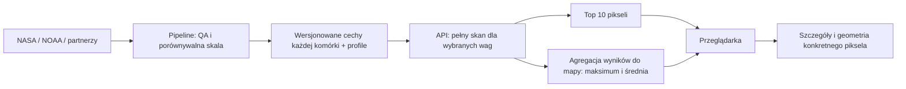

# Architektura startowa

Decyzja projektowa: **Python do przygotowania danych i globalnego skanu; React do interfejsu.** Dowolne kombinacje wag i miliony komórek uzasadniają niewielki backend. Nie wysyłamy pełnego światowego rastra do przeglądarki.

## Moduły i właściciele

| Ścieżka planowana | Zakres | Właściciel |
|---|---|---|
| `pipeline/` | Pobrania, CRS, QA, siatka, ekstrakcja cech i manifesty | Kamil |
| `apps/api/` | FastAPI, walidacja, jeden silnik scoringu, pełny skan, agregaty i eksport | Kamil |
| `apps/web/` | React + TypeScript + Vite, MapLibre, panele i obsługa API | Ewelina |
| `contracts/` | Schematy, fixture'y i wersje formatu | Kamil publikuje, Ewelina konsumuje |
| `data/` | Małe metadane w Git; duże produkty poza historią Git | Kamil |
| `submission/` | Publiczny pakiet po angielsku | Ewelina |

Szkielet aplikacji tworzą dopiero zadania K-001/E-001. Nie ma tu jeszcze zainstalowanych bibliotek. Wersje zależności i lockfile'y są częścią tych kart, po weryfikacji kompatybilności. Dokumentacja: [FastAPI](https://fastapi.tiangolo.com/), [Vite](https://vite.dev/guide/), [MapLibre](https://maplibre.org/maplibre-gl-js/docs/).

## Przepływ

## Backend bez rozbudowanej infrastruktury

- NumPy / tablice kolumnowe, opcjonalnie Parquet + memory mapping. Bez obiektu Python dla każdego piksela i bez bazy PostGIS w P0.
- Raster 60 arc-second to ok. 233 mln pozycji całej Ziemi, przed maską lądu i QA. Dla 50–100 mln ważnych pozycji trzy cechy float32 to ok. 0,6–1,2 GB, zanim dodamy maski i bufory. Liczby są oszacowaniem do benchmarku G1, nie zmierzonym kosztem ani deklaracją pokrycia.
- Pracujemy na partiach i memory mappingu; globalny zbiór może przekraczać RAM hosta. Nie zmniejszamy go po cichu przez wybór regionów o dobrej średniej.
- ID to wersja siatki + wiersz/kolumna lub równoważny stabilny klucz. Przechowujemy je kompaktowo, a w API przekazujemy jako string, aby nie tracić precyzji JavaScript.
- Wagi są normalizowane raz. Dla wydania i profilu można przygotować wektory podobieństwa poszczególnych warstw, ale łączny wynik i Top K obliczamy dla aktualnej konfiguracji.
- Przy wymaganej małej pamięci: skan partii + kopiec Top K + akumulatory mapy. Obliczenia mają te same wyniki co pełne sortowanie na kontrolnej próbce.
- Dla `distinct_areas` osobna ścieżka wyboru z posortowanych kandydatów / zewnętrznych partii; nie wolno brać tylko pierwszej dziesiątki.
- Cache zawiera wersje danych, modelu, profilu, znormalizowane wagi, filtry, tryb i odległość. Zamrożony wynik ma identyfikator analizy i nie mutuje po zmianie plików.

## Mapa

P0: API zwraca ograniczoną liczbę koszyków mapowych, np. bloków 60 × 60 pikseli bazowych, dla pełnego zasięgu. Koszyk ma maksimum, średnią ważoną powierzchnią, ID maksimum i pokrycie. Przy zoomie API udostępnia komórki z bbox i limitami; powiększanie mapy nie zmienia globalnego rankingu. Piramida mapowa nie zastępuje siatki analitycznej.

Najlepsze piksele mają zawsze osobne markery. Rzeczywisty obrys i rozmiar pojawiają się po wybraniu. Południk 180° i komórki polarne wymagają testów geometrii. Polarny zakres wymaga widoku, który potrafi go pokazać — samo domyślne Web Mercator nie wystarcza.

Podkład wybiera Ewelina z uwzględnieniem licencji i limitów. Biblioteka MapLibre nie daje automatycznie darmowego hostingu kafli. Awaria podkładu nie usuwa rankingu ani punktów wynikowych. Prywatne klucze źródeł pozostają po stronie pipeline'u.

## Cele wydajności do pomiaru w G1 / I-004

| Pomiar | Cel operacyjny P0 |
|---|---|
| Globalna analiza po wczytaniu danych | startowy budżet do 15 s na zadeklarowanym sprzęcie, p95 z co najmniej 20 zapytań; zamrozić po G1 |
| Ciepły cache tej samej analizy | do 1 s |
| Proces API | do 2 GB RAM, bez wielu kopii pełnego zbioru |
| Odpowiedź mapy | docelowo do 3 MB po kompresji, bez pełnego rastra |
| Długi / przerwany request | jawny stan oczekiwania i błąd, brak podmiany wyniku starą odpowiedzią |

To budżety, nie obietnice. Benchmark zapisuje sprzęt, wersję danych, liczbę komórek, czas, pamięć i poprawność. Jeśli cel nie jest osiągalny, zmiana siatki lub trybu pracy wymaga jawnego wpisu w `docs/DECISIONS.md` i aktualizacji kontraktu.

## Uruchomienie i wydanie

Docelowo lokalnie frontend i API uruchamiane według sprawdzonych instrukcji. Wydanie może działać pod jednym originem: API serwuje zbudowany frontend i wersjonowane dane z dysku / storage. Alternatywnie frontend statyczny i API z jawnym CORS. K-001/I-004 ustalają konkretny sposób po sprawdzeniu hostingu, kosztu i limitów.

Wyszukiwanie ma limity liczby cech, rozmiaru requestu, wyników bbox i czasu; walidujemy wartości numeryczne i identyfikatory. Dane wejściowe są wersjonowanym pakietem przygotowanym wcześniej. Zgłoszenie konkursowe nie zależy od pobierania wielkich danych NASA na żywo podczas demonstracji.
