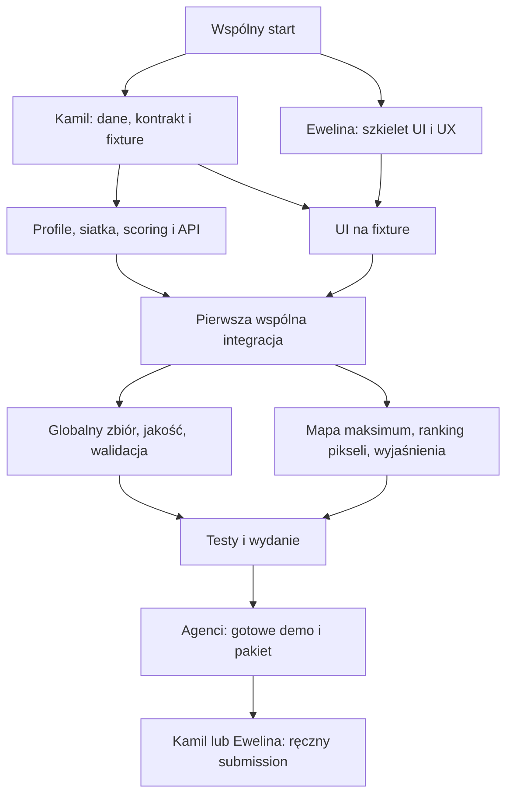

# Plan wykonania krok po kroku

Plan na dwie osoby i orientacyjnie 24–32 godziny pracy na osobę w ramach weekendu. Czasy oznaczają czas od rozpoczęcia wspólnej pracy, nie obowiązek pracy bez odpoczynku. Termin lokalnego wydarzenia może wymusić wcześniejsze zakończenie.

## 1. Ustalcie wspólny start — T+0–1 h

1. Wybierzcie nazwę zespołu i potwierdźcie event oraz jego strefę i lokalny termin.
2. Używajcie wspólnego remote [kamilr2000/Ewkam_Lab_NASA](https://github.com/kamilr2000/Ewkam_Lab_NASA). Każda osoba klonuje je na własny komputer i potwierdza dostęp zapisu; I-001 obejmuje pierwsze zasilenie i uprawnienia.
3. Przyjmijcie proponowany podział; wymiana ról wymaga aktualizacji kart.
4. Po skonfigurowaniu własnego dostępu Kamil rezerwuje K-001, Ewelina E-001. Każda rezerwacja wymaga osobnego commita IN PROGRESS opublikowanego w `origin/main` przed kodowaniem. Oboje sprawdzają `docs/sources/`.

Wynik: wspólny obieg zmian przez remote, gotowe środowiska i jasne granice. Karty: I-001, K-001, E-001. Wszystkie dalsze etapy stosują pętlę: mała poprawka → commit → synchronizacja i rozwiązanie konfliktów → push; zakończenie dopiero po integracji do `origin/main`.

## 2. Zamknijcie kontrakt i wykonalność — T+1–3 h

1. Kamil wybiera konkretne produkty, próbnie pobiera mały fragment Ziemi, Marsa i Księżyca, rejestruje wersje, jednostki i prawa.
2. Sprawdza liczbę komórek, pamięć i pełny przebieg obliczeń dla pikseli globalnego rastra 60 arc-second; zaczyna od małej próbki technicznej. Nie zastępuje pikseli średnimi większych obszarów.
3. Publikuje kontrakt v1 i syntetyczne fixture'y, w tym pojedynczy hotspot.
4. Ewelina buduje interfejs na fixture'ach i zapisuje wymagane stany mapy.

**Bramka G1:** źródła są faktycznie osiągalne, wybrana skala mieści się w pamięci, obie strony czytają te same pola. Bez tej bramki nie obiecujemy globalnego wyszukiwania ani określonej rozdzielczości. Karty: K-002, K-003, E-002, E-003.

## 3. Doprowadźcie do pierwszego pełnego przepływu — T+3–8 h

1. Kamil tworzy profile z realnych regionów, wyrównuje skalę DEM i przelicza niewielki rzeczywisty wycinek.
2. Implementuje silnik podobieństwa i wyszukiwanie każdej komórki; API udostępnia wynik i mapowe maksimum.
3. Ewelina podłącza wybór celu, kryteriów, wag, mapę i ranking do API.
4. Oboje przechodzą ścieżkę: jedna warstwa → analiza → Top 10 → szczegóły piksela.

**Bramka G2:** działa rzeczywisty pionowy przepływ. Ograniczony wycinek pozostaje oznaczony jako regionalny. Karty: K-004, K-005, K-006, K-007, E-004, E-005, I-002.

## 4. Rozszerzcie obliczenia na cały zbiór — T+6–15 h

1. Kamil buduje globalne cechy w partiach, zachowując braki danych i maski lądu; publikuje manifest oraz raport zasięgu.
2. Wyszukiwanie globalne skanuje każdą kwalifikującą się komórkę. Żaden średni wynik regionu nie ogranicza kandydatów.
3. Mapa korzysta z agregacji **wyników pikseli** po obliczeniu: maksimum + średnia + liczność + identyfikator maksimum.
4. Ewelina dodaje zoom do rzeczywistego piksela, brak danych, legendę, progres i zabezpieczenie przed starymi odpowiedziami.
5. Kamil sprawdza fragmenty na NASA Earth DEM i zapisuje wpływ różnic źródeł.

**Bramka G3:** globalność potwierdzona raportem; pojedynczy piksel przechodzi do Top 10 mimo słabego otoczenia. Karty: K-005, K-007, K-008, E-004, E-006, I-003.

## 5. Wyjaśnijcie wynik i granice — T+12–20 h

1. Ewelina prezentuje surowe wartości, jednostki, wkłady wag, zakresy referencji oraz jakość i skalę komórki.
2. Dodaje drugi widok Top 10 różnych obszarów, z jawnym dystansem i dostępem do najlepszych pikseli wewnątrz grupy.
3. Kamil prowadzi przegląd przypadków: znane analogi, nieoczekiwani kandydaci, słabe kontrprzykłady i hotspoty izolowane.
4. Dodajecie eksport konfiguracji i wyników z wersjami danych. Sprawdzacie ręcznie jeden wynik MCDA.

Karty: K-008, K-009, E-006, E-007, I-003.

## 6. Dodajcie niezależną warstwę, jeśli P0 już działa

1. Wybierzcie jedną z opcji po audycie: temperatura, odsłonięcie gruntu albo pilotaż minerałów.
2. Dla minerałów najpierw porównajcie dwa udokumentowane wycinki i słownik klas. Nie publikujcie globalnego „% minerałów”, jeśli źródła są regionalne lub opisują różne wielkości.
3. Nowa warstwa przechodzi te same testy braków, jednostek, skali i pokrycia. Rzeczywista rola proxy jest widoczna w UI.

To P1, z osobną decyzją o zakresie. Karty: K-010, K-011, E-011. Zbyt mało czasu oznacza pozostawienie kart w backlogu i opisanie rozszerzenia jako przyszłe.

## 7. Sprawdźcie całość i przygotujcie wydanie — T+20–26 h

1. Uruchomcie testy naukowe, kontraktowe i pełny scenariusz UI z `docs/VALIDATION.md`.
2. Sprawdźcie telefon, klawiaturę, nieudane pobranie danych i pusty ranking.
3. Zmierzcie czas dla finalnego globalnego zbioru i pamięć procesu; w razie przekroczenia budżetu stosujcie jawny fallback.
4. Przygotujcie uruchomienie jednym sposobem i publiczne wydanie. Wszystkie linki sprawdźcie bez logowania.

Karty: E-008, E-009, I-003, I-004. Nie zmieniajcie rozdzielczości tylko w rankingu lub tylko w mapie.

## 8. Agenci przygotowują pakiet; człowiek wysyła — końcowa rezerwa

1. Ewelina przygotowuje angielski pakiet w `submission/` i demo według wybranego formatu z `docs/sources/03-submission.md`.
2. Kamil weryfikuje źródła i zgodność twierdzeń z działającą wersją.
3. Oboje sprawdzacie kompletność materiałów, licencje i ujawnienie AI.
4. Wyłącznie Kamil albo Ewelina osobiście wykonuje formalne zgłoszenie, zachowuje potwierdzenie i odnotowuje moment wysłania. Agenci nie wysyłają submission ani nie składają oświadczeń. Ich Cele kończą się gotowym projektem i pakietem do ręcznego zgłoszenia.

Karty agentów: E-010 i I-005. Karta człowieka: I-006 (human_only), wyłączona z wykonawczych Celów agentów. Zarezerwujcie co najmniej 2 godziny przed właściwym terminem; lokalny pitch może być wcześniej.

## Zależności i praca równoległa

## Fallback bez ukrywania ograniczeń

- Zbyt wolny globalny zbiór: ta sama metoda na **jawnie grubszej globalnej siatce** z nowym `dataset_version`; pełny skan nadal obowiązuje.
- Brak danych globalnych: publikacja trybu regionalnego z wymienionym zasięgiem; G3 pozostaje niespełniona i nie ogłaszamy pełnego MVP globalnego.
- Brak dynamicznego hostingu: statyczne demo z kilkoma zapisanymi konfiguracjami, wyraźnie opisane jako ograniczone; dowolne wagi działają w wersji uruchamianej lokalnie.
- Brak minerałów: wyłączona warstwa z opisem planu, bez losowych lub ręcznie wymyślonych procentów.
- Wyższa rozdzielczość tylko lokalnie: osobny eksperyment, osobny ranking i zasięg, bez mieszania z globalnymi wynikami.
