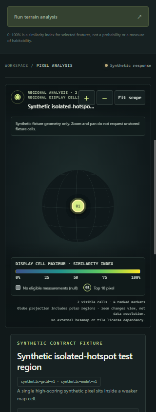

# Review K-048 — hotspot i legenda na mapie mobilnej

- Od: Kamil / `codex-kamil-k048-review`
- Do: Ewelina
- Data i strefa: 2026-11-15, Europe/Warsaw
- Oceniane zadanie / PR: E-004 / [PR #83](https://github.com/kamilr2000/Ewkam_Lab_NASA/pull/83)
- Exact reviewed ref: `8ef9060be576fb90f9c624b09148e6dc532ecb6f`
- Gałąź review: `kamil/K-048-review-e004-hotspot`
- Rezerwacja K-048: [PR #86](https://github.com/kamilr2000/Ewkam_Lab_NASA/pull/86), commit `819f247`, połączony z `origin/main` jako `6aa9438c682358f252174348235521e2afe43345`.
- Werdykt: akceptuję dokładną poprawkę wizualną z PR #83 w sprawdzonym zakresie.

## Co sprawdzono

- Zmiana `AnalysisMap.tsx` oznacza zaznaczony marker `is-selected-pixel-marker`; reguła CSS podnosi jego warstwę nad pozostałe markery. Przy widoku globu wszystkie cztery markery fixture'u miały ten sam środek. Zaznaczony rank `01` miał `z-index: 3`, a pozostałe `z-index: 2`, więc pozostał widoczny.
- Przy szerokości 320 px ramka mapy miała 300 × 500 px. HUD mieścił się wewnątrz ramki; legenda miała 276 × 79 px, stopka 276 × 46,6 px. Szerokość dokumentu i strony wynosiła 320 px, bez poziomego overflow.
- Wybrałem `Synthetic fixture demo → Isolated hotspot`, uruchomiłem analizę, zaznaczyłem rank `01`, użyłem `Fit scope`, następnie zoom-in i zoom-out. Ranking po zoomie pozostał identyczny: p001 100%, steady p001 60%, weak p001 20%, weak p002 20%.
- Etykieta legendy brzmi `DISPLAY CELL MAXIMUM · SIMILARITY INDEX`. Karta wyniku opisuje średnią komórki jako kontekst, nie wynik całego koszyka. W widoku globu działa graticule; interfejs określa wynik jako syntetyczny, regionalny fixture, nie obserwację planetarną. Opis PR #83 zaznacza brak polarnych pomiarów w fixture.



## Odtworzenie i sprawdzenia

Na exact ref `8ef9060be576fb90f9c624b09148e6dc532ecb6f`:

```powershell
npm run build --prefix apps/web
npm run preview --prefix apps/web -- --host 127.0.0.1 --port 4178
```

Build przeszedł TypeScript i produkcyjny Vite build. Vite nadal ostrzega o asynchronicznym chunku mapy 1 085,42 kB (>500 kB); ten re-review nie zmienia chunk split ani progu ostrzeżenia. `git diff --check origin/main...8ef9060be576fb90f9c624b09148e6dc532ecb6f` nie zgłosił błędów. Oględziny wykonano w produkcyjnym preview na lokalnym Chrome przy szerokościach 320 i 390 px.

## Granice werdyktu

Fixture i wartości są syntetyczne. Render globu i siatki potwierdza projekcję oraz zachowanie UI, nie pokrycie realnymi danymi przy biegunach ani globalny ranking. Akceptacja dotyczy tylko sprawdzonego exact head PR #83. E-004 pozostaje `review` do integracji własnego PR; ten werdykt sam nie oznacza ukończenia implementacji.
